<div align="center">



</div>

<div align="center">

</div>

```text
$ whoami
Sviluppatore .NET in FManager, da quasi tre anni.
Gestionali per la ceramica, dalle macchine di reparto all'ERP.
Seguo i progetti dall'analisi con il cliente fino all'installazione in reparto.
```

> 🇬🇧 **In short:** .NET developer building manufacturing software (MES/WMS) for the ceramics industry: WPF desktop apps, SQL Server, PLC and ERP integrations, and LLMs connected to company data. Based near Rome, Italy.

## `$ stack`


## `$ ls progetti/`

Sono software di lavoro: il codice non è pubblico, ma ecco cosa fanno.

<details>
<summary><b>FactoryManager</b> · il MES per la ceramica</summary>

<br>

Segue la produzione di sanitari in ceramica dal colaggio al controllo qualità fino alla spedizione. Desktop WPF (MVVM) su .NET, Entity Framework Core e SQL Server; report con DevExpress XtraReports.

</details>

<details>
<summary><b>ClockIn</b> · presenze, accessi e un bot con LLM</summary>

<br>

Presenze e controllo accessi con terminali Anviz, apertura delle porte da remoto e report. Un bot Telegram risponde alle domande sulle presenze e crea grafici, con modelli OpenAI o locali, collegati ai dati tramite Model Context Protocol.

</details>

<details>
<summary><b>Serial To API</b> · i PLC via seriale, in REST</summary>

<br>

Legge e scrive le memorie dei PLC via seriale e le espone come API REST. Gira a bordo delle macchine di colaggio e riceve le ricette di lavorazione dal gestionale.

</details>

<details>
<summary><b>StockPilot</b> · magazzino con app, API e desktop</summary>

<br>

Un WMS per carichi e scarichi: app mobile in .NET MAUI, server API e applicazione desktop.

</details>

<details>
<summary><b>TagsHandler</b> · dati macchina da OPC-UA e REST</summary>

<br>

Il modulo che raccoglie i dati delle macchine da OPC-UA, API REST e altri protocolli. Le mappature stanno in file XML: una macchina nuova si configura senza ricompilare.

</details>

<details>
<summary><b>Pro-Duck-tion AI</b> · domande in chat, grafici dai dati</summary>

<br>

Prototipo dimostrativo: da una domanda scritta su Telegram genera uno script Python sui dati di produzione e restituisce grafici e statistiche. Usa più modelli locali, tra cui Phi-4, gestiti con LocalAI.

</details>

## `$ now`

- 🤖 modelli linguistici collegati ai dati dei gestionali, anche in locale, con MCP
- 🧱 .NET 10, WPF e integrazioni con le macchine di reparto

## `$ fuori-orario`

✈️ pilota di ultraleggeri alla Celsetta · 🚁 droni · 🎹 tastiere in una band · 🖥️ home lab con Proxmox, Docker e un NAS

## `$ contatti`

| | |
|---|---|
| 🌐 Sito | [michelefelici.com](https://michelefelici.com) |
| 💼 LinkedIn | [linkedin.com/in/felicimichele](https://www.linkedin.com/in/felicimichele/) |
| ✉️ Email | hi@michelefelici.com |

Per scrivermi in modo cifrato, la mia chiave PGP ha questa impronta:

```text
DE86 4F82 537C 233D DECF 08F6 D735 BC89 0DB7 5372
```
